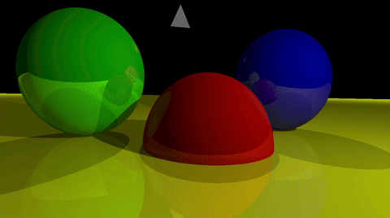

<p align="center">
  
</p>

# rray

Realtime software Raytracer in C

**Usage:** Move around the scene with Arrow keys or `WASD` and look around using the mouse. Use `ESC` to quit.

**Features**
- Sphere & triangle primitives
- Phong lighting with point, directional & ambient lights
- Recursive reflections
- Free camera movement
- OpenMP parallel rendering

Stable 30fps at 1280x720 on a Ryzen 5 7535U. 

## Build from source

Running requires a POSIX-compliant environment, e.g. Linux or MacOS.

Install [`SDL3`](https://libsdl.org/). Optionally, install [`OpenMP`](https://www.openmp.org/) for multithreading support & improved performance. Build with [`CMake`](https://cmake.org/). First run:
```bash
cmake -S . -B build -DCMAKE_BUILD_TYPE=Release
```
to configure `CMake`. Then build with:
```bash
cmake --build build
```
If the build was successful, run the renderer with
```bash
./build/rray
```
If the raytracer is too demanding, run with `-s` or `--static` to render & display only one frame.

## Development

Configure `CMake` to include debug info & sanitization:
```bash
cmake -S . -B build -DCMAKE_BUILD_TYPE=Debug
```
You may need to install `libasan` and `libubsan`.

Format everything with `clang-format`:
```bash
./format.sh
```

## References
- Fundamentals of Computer Graphics, 5th Edition
- [Computer Graphics From Scratch](https://www.gabrielgambetta.com/computer-graphics-from-scratch/)
- [SDL3 Wiki](https://wiki.libsdl.org/SDL3/FrontPage)
- [OpenMP Reference Guide](https://www.openmp.org/resources/refguides/)
- [CMake Tutorial](https://cmake.org/cmake/help/latest/guide/tutorial/index.html)